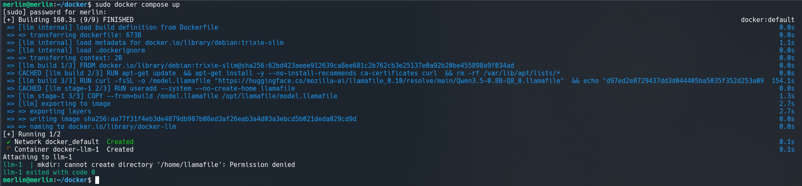
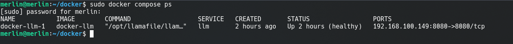
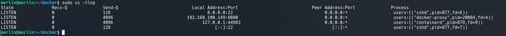
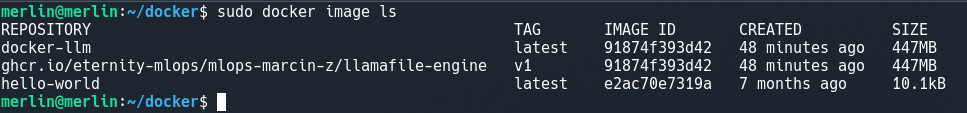
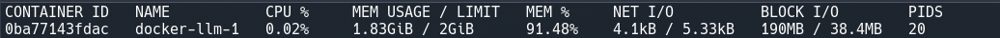
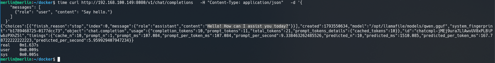

# Dokumentacja: Bezpieczne środowisko Docker dla modelu llamafile

Zadanie polega zainstalowaniu środowiska Docker i uruchomieniu w kontenerze modelu językowego. Obraz zbudowany jest na podstawie przygotowanego pliku 'Dockerfile', a usługa opisana jest w 'compose.yaml'. Wagi modelu dołączone są do jako wolumen.

## 1. Instalacja środowiska Docker na systemie Debian

Rozpoczęto od aktualizacji repozytoriów systemu operacyjnego i instalacji niezbędnych pakietów do konteneryzacji.

*   `sudo apt-get update`
    Aktualizacja list pakietów z repozytoriów.
*   `sudo apt-get install -y docker.io docker-compose`
    Instalacja silnika Docker oraz narzędzia Docker Compose.
    *   **Flaga `-y` (Yes):** Automatycznie akceptuje wszystkie monity instalatora, nie wymagając interakcji użytkownika.
*   `sudo systemctl enable --now docker`
    Uruchomienie usługi Docker i dodanie jej do autostartu systemu.

## 2. Przygotowanie struktury katalogów i pobranie modelu

Utworzono dedykowany folder roboczy dla projektu oraz podkatalog na wagi modelu. Wagi zostały pobrane bezpośrednio na maszynę gospodarza, aby dołączać je do kontenera w trybie read-only.

*   `mkdir -p ~/docker/models`
    Utworzenie struktury katalogów projektu.
    *   **Flaga `-p` (Parents):** Tworzy ścieżkę wraz ze wszystkimi niezbędnymi katalogami nadrzędnymi, jeśli te nie istnieją.
*   `cd ~/docker`
    Przejście do głównego katalogu projektu.
*   `curl -L -o models/qwen.gguf https://huggingface.co/Qwen/Qwen1.5-0.5B-Chat-GGUF/resolve/main/qwen1_5-0_5b-chat-q8_0.gguf`
    Pobranie wag modelu (bez wbudowanego silnika).
    *   **Flaga `-L` (Location):** Wymusza podążanie za przekierowaniami HTTP.
    *   **Flaga `-o` (Output):** Zapisuje strumień do wskazanego pliku.

## 3. Pliki konfiguracyjne środowiska

W katalogu projektu (`~/docker`) utworzono trzy niezbędne pliki definiujące środowisko.

### Plik `.env` (Zmienne środowiskowe)
Plik przechowujący parametry sieciowe, wskaźniki modelu oraz link i sumę kontrolną silnika, co pozwala na pełne zarządzanie środowiskiem bez edycji kodu Dockera.

```env
HOST_ONLY_ADDRESS=192.168.100.149
PORT=8080
THREADS=4
MODEL_FILE=qwen.gguf
LLAMAFILE_URL=https://huggingface.co/mozilla-ai/llamafile_0.10/resolve/main/llamafile-0.10.6
LLAMAFILE_SHA256=d579f61dcd3a306f518e6d90e599d77793ed5f09543023d09c96ad35fcfa63f0
```

### Plik `Dockerfile`
W pierwszym etapie pobierany jest lekki silnik, weryfikowana jest jego suma kontrolna SHA-256 oraz następuje asymilacja do formatu ELF. W drugim etapie silnik przenoszony jest do środowiska działającego z poziomu użytkownika bez uprawnień roota.

```dockerfile
FROM debian:trixie-slim AS build
ARG LLAMAFILE_URL
ARG LLAMAFILE_SHA256
RUN apt-get update \
 && apt-get install -y --no-install-recommends ca-certificates curl \
 && rm -rf /var/lib/apt/lists/*
RUN curl -fsSL -o /llamafile "$LLAMAFILE_URL" \
 && echo "$LLAMAFILE_SHA256  /llamafile" | sha256sum -c - \
 && chmod +x /llamafile \
 && sh /llamafile --assimilate

FROM debian:trixie-slim
RUN useradd --system --no-create-home llamafile \
 && mkdir -p /opt/llamafile/models \
 && chown -R llamafile:llamafile /opt/llamafile
COPY --chown=llamafile:llamafile --from=build /llamafile /opt/llamafile/llamafile
ENV HOME=/tmp
USER llamafile
EXPOSE 8080
ENTRYPOINT ["/opt/llamafile/llamafile", "--server", "--host", "0.0.0.0"]
CMD ["--port", "8080"]
```

### Plik `compose.yaml`
Definicja usługi, która uwzględnia reguły bezpieczeństwa (izolacja, read-only rootfs, czyszczenie uprawnień) oraz dołącza pobrany model do kontenera.

```yaml
services:
  llm:
    build:
      context: .
      args:
        LLAMAFILE_URL: ${LLAMAFILE_URL}
        LLAMAFILE_SHA256: ${LLAMAFILE_SHA256}
    ports:
      - "${HOST_ONLY_ADDRESS}:${PORT}:8080"
    volumes:
      - ./models:/opt/llamafile/models:ro
    restart: unless-stopped
    mem_limit: 2g
    cpus: 2
    init: true
    read_only: true
    tmpfs:
      - /tmp
    cap_drop:
      - ALL
    security_opt:
      - no-new-privileges:true
    command: ["-m", "/opt/llamafile/models/${MODEL_FILE}", "--port", "${PORT}", "-t", "${THREADS}"]
    healthcheck:
      test: ["CMD", "bash", "-c", "exec 3<>/dev/tcp/127.0.0.1/8080"]
      interval: 10s
      start_period: 60s
```

## 4. Budowa i uruchomienie usługi

*   `sudo docker compose up -d --build`
    Budowanie obrazu na podstawie `Dockerfile` i uruchomienie kontenera w tle.
    *   **Flaga `-d` (Detached):** Uruchamia kontenery w tle i oddaje kontrolę nad terminalem.
    *   **Flaga `--build`:** Wymusza \budowanie/przebudowanie obrazu przed uruchomieniem kontenera.
    

## 5. Sprawdzenie działania

*   **Status usługi i weryfikacja Healthcheck:**
    Wynik polecenia `sudo docker compose ps` pokazujący, że kontener przeszedł pomyślnie testy dostępności portu (status: healthy):
    

*   **Sprawdzenie dostępności portu na maszynie gospodarza:**
    Wynik polecenia `sudo ss -tlnp` potwierdzający nasłuchiwanie na adresie Host-Only:
    

*   **Zbudowany obraz:**
    Wynik polecenia `sudo docker image ls` pokazujący rozmiar obrazu:
    

*   **Sprawdzenie statystyk:**
    Wynik polecenia `sudo docker stats` pokazujący statystyki:
    

## 6. Test komunikacji REST API

Wysłanie zapytania JSON z wiersza poleceń do uruchomionego serwera zgodnego z API OpenAI za pomocą narzędzia `curl`. Użyto dodatkowo narzędzia `time` do weryfikacji szybkości odpowiedzi.

*   Zapytanie:
    ```bash
    time curl http://192.168.100.149:8080/v1/chat/completions \
    -H "Content-Type: application/json" \
    -d '{
      "messages": [
        {
          "role": "user",
          "content": "Say hello"
        }
      ]
    }'
    ```

*   Odpowiedź modelu i czas wykonania:
    

## 7. Tabela porównująca


| Kryterium | Usługa systemd | Docker |
| :--- | :--- | :--- |
| Pamięć RAM | 598.6M (peak: 648.1M) | 1.9G |
| Miejsce na dysku | 1.2G | 447M |
| Czas od uruchomienia do pierwszej odpowiedzi | ~3s | ~6s |
| Liczba króków | 4 | 4 |

